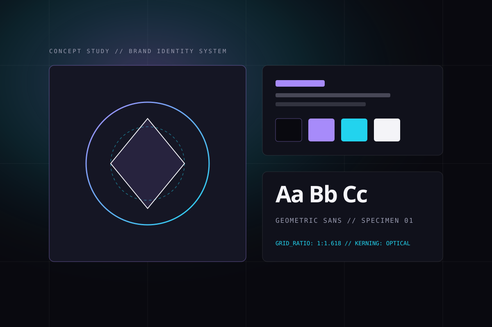

# PIXELFORGE — Creative Asset Studio

<p align="center">
  
</p>

<p align="center">
  <strong>Craft Ideas. Forge Visuals.</strong><br />
  A modern creative workspace where designers organize visual assets, manage projects, collaborate with clients, and publish high-craft portfolios.
</p>

<p align="center">
  <a href="https://pixelforge-ecru.vercel.app/">
    
  </a>
  
  
  
  
  
</p>

---

## 🌐 Live Application

- **Live URL:** [https://pixelforge-ecru.vercel.app/](https://pixelforge-ecru.vercel.app/)
- **Health Check & Diagnostics:** [https://pixelforge-ecru.vercel.app/api/v1/health](https://pixelforge-ecru.vercel.app/api/v1/health)

---

## 🔑 Cara Mengakses Aplikasi & Pengujian Akun

Anda dapat langsung mencoba aplikasi baik di versi live Vercel maupun di localhost:

| Peran (Role) | Akun Pengujian | Metode Akses | Hak Akses Utama |
| :--- | :--- | :--- | :--- |
| **Studio Owner (Desainer)** | `sora@pixelforge.studio` | Klik tombol **"Fill Studio Owner Demo"** di halaman login `/login` | Kontrol penuh atas seluruh proyek, unggah aset, buat koleksi/tag, kirim undangan klien, dan kelola pesan masuk. |
| **Client Reviewer (Klien)** | `elena.client@helio.bio` | Melalui tautan undangan proyek atau pendaftaran `/signup` | Melihat proyek yang dibagikan, membandingkan versi revisi, memberi catatan revisi, dan menyetujui deliverable (*independent sign-off*). |
| **Public Visitor (Publik)** | *(Tanpa Login)* | Akses langsung beranda & portofolio | Menjelajahi galeri portofolio publik, studi kasus, profil studio, dan mengirim pesan formulir komisi proyek. |

> [!TIP]
> Anda juga dapat mendaftarkan akun pribadi baru kapan saja melalui halaman [Sign Up](https://pixelforge-ecru.vercel.app/signup). Seluruh data proyek dan aset Anda akan diisolasi secara aman menggunakan PostgreSQL Row Level Security (RLS).

---

## 🚀 Fitur Utama

### 1. Portofolio Publik & Halaman Showcase (`/`, `/portfolio`, `/about`, `/contact`)
- **Desain Futuristik Dark-First:** Tampilan estetis khas studio kreatif dengan dukungan tema Terang (*Light Mode*) dan responsif mobile.
- **Studi Kasus Interaktif:** Rincian proses desain, *creative brief*, alat yang digunakan (*tools*), dan hasil akhir proyek.
- **Formulir Kontak Anti-Spam:** Dilindungi perangkap *honeypot* dan validasi kecepatan pengisian otomatis untuk mencegah spam tanpa captcha yang mengganggu.

### 2. Manajemen Aset Kreatif Mandiri (`/dashboard/assets`, `/dashboard/collections`)
- **Tampilan Grid & List:** Tinjau thumbnail, dimensi piksel, ukuran file, format, dan metadata aset.
- **Filter Multi-Kategori:** Filter berdasarkan tipe file (`SVG`, `PNG`, `WEBP`, `JPG`, `GIF`, `PDF`, `ZIP`), kategori desain, tag custom, dan koleksi.
- **Unggah Drag-and-Drop:** Validasi ukuran maksimal (50 MB) dan format MIME di sisi server.
- **Penyimpanan Aman (Zero-Traversal):** Nama path penyimpanan diacak dan di-hash untuk mencegah eksploitasi traversal direktori.
- **Akses URL Berjangka:** File privat dilindungi Signed URL Supabase Storage berdurasi 30 menit.
- **Aksi Massal (Bulk Actions):** Ubah visibilitas publik/privat, hapus massal, atau masukkan ke koleksi dalam satu klik.

### 3. Manajemen Proyek & Matriks Revisi (`/dashboard/projects`, `/dashboard/projects/[id]`)
- **Siklus Hidup Proyek:** Status terstruktur (`Draft`, `In Progress`, `In Review`, `Approved`, `Archived`) dengan tingkat prioritas.
- **Riwayat Versi Deliverable:** Mengunggah dan melacak versi deliverable (`v1`, `v2`, dst.) lengkap dengan catatan revisi.
- **Side-by-Side Version Comparison:** Matriks perbandingan visual dan teknis untuk melihat lompatan versi, perubahan ukuran file, dan status review antar versi.

### 4. Portal Kolaborasi Klien & Undangan Kriptografis (`/dashboard/clients`, `/invite/[token]`)
- **Undangan Sekali Pakai (Single-Use Token):** Token acak kriptografis 256-bit berbatas waktu (1–30 hari). Token mentah tidak pernah disimpan di database, hanya hash `SHA-256` (`token_hash`) yang disimpan.
- **Penerimaan Idempoten:** Mencegah eskalasi hak akses atau penggandaan anggota proyek.
- **Independent Sign-Off Enforcement:** Aturan ketat sistem yang melarang pembuat deliverable menyetujui karyanya sendiri—persetujuan akhir hanya sah dari klien/reviewer.

### 5. Telemetri Studio, Log Audit & Notifikasi (`/dashboard`, `/dashboard/activity`)
- **Dashboard Telemetri:** Statistik metrik proyek aktif, kapasitas penyimpanan terpakai, dan status alur revisi.
- **Log Audit Imutabel:** Catatan aktivitas tersanitasi otomatis (*passwords, secrets, and raw tokens are redacted*).
- **Notification Center:** Notifikasi in-app langsung dengan status baca/belum baca dan tautan langsung ke sumber daya terkait.

---

## 🛠️ Arsitektur Teknologi

- **Frontend & Server:** Next.js 15.5 (App Router, Server Actions, Route Handlers, Middleware)
- **Bahasa:** TypeScript 5.8 (Strict Type-checking)
- **Gaya & Komponen:** Tailwind CSS 3.4, Framer Motion 12, Lucide React
- **Basis Data:** Supabase PostgreSQL 15 dengan **Row Level Security (RLS)** aktif di seluruh 16 tabel
- **Penyimpanan File:** Supabase Storage (Private Bucket `creative-assets`)
- **Validasi Data:** Zod 3.24
- **Pengujian (Testing):** Vitest 3 + PGlite (In-memory real PostgreSQL engine)
- **Deployment:** Vercel (Edge & Serverless Node.js Runtime)

---

## 💻 Panduan Menjalankan di Komputer Lokal

Aplikasi memiliki fitur **Zero-Config Local Fallback Mode**, sehingga Anda dapat langsung menjalankannya tanpa konfigurasi awal Supabase:

```bash
# 1. Clone repositori ini
git clone https://github.com/v0rade/PIXELFORGE.git
cd PIXELFORGE

# 2. Pasang dependensi
npm install

# 3. Buat file environment lokal
cp .env.example .env.local

# 4. Jalankan pengujian otomatis (89 test suites)
npm run verify

# 5. Jalankan server lokal
npm run dev
```

Buka peramban Anda di [http://localhost:3000](http://localhost:3000).

---

## ⚙️ Konfigurasi Environment Variables

File [`.env.example`](.env.example) menyediakan template siap pakai:

| Variabel | Lingkungan | Wajib? | Penjelasan |
| :--- | :--- | :--- | :--- |
| `NEXT_PUBLIC_APP_URL` | Browser & Server | Ya | URL asal aplikasi (misal `http://localhost:3000` atau `https://pixelforge-ecru.vercel.app`). |
| `NEXT_PUBLIC_SUPABASE_URL` | Browser & Server | Cloud Mode | URL endpoint project Supabase (`https://<project-ref>.supabase.co`). |
| `NEXT_PUBLIC_SUPABASE_PUBLISHABLE_KEY` | Browser & Server | Cloud Mode | Publishable/Anon Key Supabase (aman untuk browser karena dilindungi RLS). |
| `SUPABASE_SERVICE_ROLE_KEY` | Server-Only | Opsional | Kunci admin Supabase (rahasia, tidak pernah diekspos ke browser). |
| `RESEND_API_KEY` | Server-Only | Opsional | Kunci API Resend jika ingin mengaktifkan pengiriman email notifikasi asli. |
| `EMAIL_FROM` | Server-Only | Opsional | Alamat email pengirim (default: `notifications@pixelforge.studio`). |

---

## 🗄️ Menyiapkan Database Supabase (Production)

File skema dan kebijakan keamanan telah disiapkan di folder [`supabase/migrations/`](supabase/migrations/):

1. **`20261016000001_initial_schema.sql`**: Membuat seluruh 16 tabel, foreign keys, relasi, constraint, indeks performa, dan trigger inisialisasi akun pengguna baru.
2. **`20261016000002_rls_policies.sql`**: Mengaktifkan `FORCE ROW LEVEL SECURITY` pada seluruh tabel dan mengonfigurasi bucket privat `creative-assets`.
3. Jalankan kedua file tersebut melalui **Supabase Dashboard $\rightarrow$ SQL Editor** atau menggunakan Supabase CLI:
   ```bash
   npx supabase link --project-ref <PROJECT_REF>
   npm run db:migrate
   ```

---

## 🧪 Skrip Pengujian & Kualitas Kode

```bash
# Menjalankan seluruh test suite Vitest & PostgreSQL RLS (89 tests)
npm test

# Pengecekan linter ESLint (0 errors, 0 warnings)
npm run lint

# Validasi tipe statis TypeScript (0 errors)
npm run typecheck

# Audit keamanan dependensi
npm audit --omit=dev

# Kompilasi build produksi Next.js
npm run build
```

---

## 🔒 Catatan Keamanan

- **Row Level Security (RLS):** Semua query ke Supabase divalidasi langsung di level database berdasarkan token JWT pengguna yang login.
- **Proteksi IDOR:** Pengguna tidak dapat membaca atau menyunting proyek, aset, notifikasi, maupun pesan milik pengguna lain.
- **Proteksi Rate Limiting:** Endpoint autentikasi, pemulihan sandi, dan formulir publik dilindungi pembatas laju geser (*sliding-window rate limit*) dengan respons `429 Too Many Requests`.
- **Header Keamanan HTTP:** Dilengkapi Content-Security-Policy (CSP), Strict-Transport-Security (HSTS), X-Frame-Options (DENY), dan nosniff.

---

## 📄 Lisensi

Didistribusikan di bawah lisensi private studio. Hak cipta dilindungi undang-undang.
